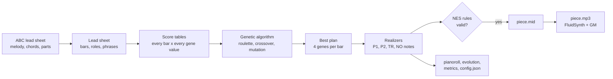

# TP1 – A Genetic Algorithm that Arranges Songs for the NES Sound Chip

DCC831 – Generative AI for Music (UFMG, 2026/2). Assignment 1: algorithmic composition.

This project re-composes a song as 8-bit music. It reads a lead sheet (a melody with chord symbols
and part labels) and arranges it for the four voices of the Nintendo Entertainment System (NES)
sound chip. A **genetic algorithm** (GA) chooses, bar by bar, what each voice plays.

## Method

**Stylistic constraint: the NES 2A03 four-voice idiom.** The chip has four channels, and each one
plays one note at a time:

| Channel | Wave | Role in the arrangement | Textures the GA can choose per bar |
|---|---|---|---|
| P1 | pulse (square) | melody, as written in the lead sheet | octave: as written, one up, one down |
| P2 | pulse (square) | harmony | hold, 16th arpeggio, 32nd arpeggio, echo of P1, chord tone below the melody |
| TR | triangle | bass | root, octave pump, root–fifth, walking line |
| NO | noise | percussion (kick, snare, hi-hat) | none, half time, eighth beat, sixteenth beat, fill |

Because each channel is monophonic, chords become arpeggios, and a bass line and a drum part must
be invented. That is why an 8-bit cover is a re-composition and not a copy. Every arrangement is
checked against these rules before export: one note at a time per channel, the channel pitch
ranges (pulse MIDI 33–108, triangle 21–108), chord tones on strong beats for P2 and TR, and
complete 4/4 bars.

**Genetic algorithm.**

- **Genotype:** 4 integer genes per bar (P2 texture, TR texture, NO pattern, P1 octave).
  Deterministic *realizers* turn each gene value into the notes of the bar, so every genotype is
  a valid arrangement.
- **Initial population:** random genotypes (60 by default).
- **Fitness:** a weighted mean of seven music-theory criteria, each from 0 to 1:
  - *complementarity*: P2 calm when the melody is busy, active when it rests;
  - *register*: P2 below P1;
  - *coherence*: the same textures inside a 4-bar phrase;
  - *contrast*: the chorus denser than the verse;
  - *bass smoothness*: small leaps of the bass between bars;
  - *idiom*: arpeggios over long chords, drum fills at phrase ends;
  - *fidelity*: the melody stays in its written octave.
- **Selection:** roulette wheel with windowing (fitness minus the generation's minimum), plus
  elitism (the 2 best plans survive unchanged).
- **Crossover:** one cut point, only between bars.
- **Mutation:** each gene changes with probability 0.01.
- **Stopping:** 1000 generations, or 100 generations without improvement.

All hyperparameters are in [configs/default.json](configs/default.json) and can be changed with
`--set`, for example `--set weights.contrast=3`. The design is in
[specs/001-ga-chiptune-arranger/](specs/001-ga-chiptune-arranger/).



## Layout

- `src/`: source code (entry point: `src/main.py`)
  - `leadsheet/`: ABC reading and chord helpers
  - `arrangement/`: realizers, assembly, NES rule validation
  - `ga/`: genotype, operators, score tables, fitness, evolution loop
  - `analysis/`: objective metrics
  - `export/`: MIDI, audio, figures, run folders
- `data/leadsheets/`: the input lead sheets
- `configs/default.json`: default hyperparameters
- `tests/`: tests (pytest); the docstring examples in `src/` also run as tests
- `samples/`: curated generated pieces (MIDI, MP3, piano roll, evolution, metrics, config, notes)
- `outputs/`: every generation run, one folder per run (not versioned)
- `paper/`: the ISMIR abstract (`tp1.tex`), with the official ISMIR 2026 template files from
  [ismir/paper_templates@2026v1](https://github.com/ismir/paper_templates/tree/2026v1/2026/latex)
- `specs/` and `.specify/`: [Spec Kit](https://github.com/github/spec-kit) design documents; the
  project rules are in `.specify/memory/constitution.md`

## Installation

The project uses [uv](https://docs.astral.sh/uv/) and Python 3.12.

```bash
uv sync
```

Without uv, use `requirements.txt`:

```bash
python3 -m venv .venv && source .venv/bin/activate && pip install -r requirements.txt
```

To render audio, install FluidSynth, a General MIDI soundfont and ffmpeg. On Debian/Ubuntu:

```bash
sudo apt install fluidsynth fluid-soundfont-gm ffmpeg
```

## Usage

Arrange a lead sheet (the seed is required):

```bash
uv run src/main.py arrange data/leadsheets/korobeiniki.abc --seed 1
```

Each run writes `outputs/<input>-s<seed>-<config hash>/` with:

- `piece.mid` and `piece.mp3`;
- `pianoroll.png` and `pianoroll.pdf`;
- `evolution.csv`, `evolution.png` and `evolution.pdf`;
- `metrics.json`;
- `config.json`: the seed, every hyperparameter, the input hash, the git commit and the date.

Copy a run to the curated samples, and its vector figures to `paper/figures/`:

```bash
uv run src/main.py sample outputs/<run-id> <sample-name>
```

Run the tests:

```bash
uv run pytest
```

## Reproducing the results

Each sample was made by one `arrange` command and copied with `sample`. The same command
rebuilds the same notes. The run folder name ends with the hash of the configuration: `95456f9f`
is the default configuration.

```bash
uv run src/main.py arrange data/leadsheets/ievan_polkka.abc --seed 1
uv run src/main.py sample outputs/ievan_polkka-s1-95456f9f ievan-polkka-s1
```

```bash
uv run src/main.py arrange data/leadsheets/ievan_polkka.abc --seed 1 --set weights.contrast=0
uv run src/main.py sample outputs/ievan_polkka-s1-175532e9 ievan-polkka-s1-contrast0
```

```bash
uv run src/main.py arrange data/leadsheets/korobeiniki.abc --seed 1
uv run src/main.py sample outputs/korobeiniki-s1-95456f9f korobeiniki-s1
```

```bash
uv run src/main.py arrange data/leadsheets/korobeiniki.abc --seed 2
uv run src/main.py sample outputs/korobeiniki-s2-95456f9f korobeiniki-s2
```

The experiments of the abstract compare 5 seeds, a random-search baseline and an ablation that
sets each criterion weight to 0. Each command writes `outputs/experiment-<song>-s1-<hash>/`
with `results.csv`, `results.md` and `seeds.pdf`:

```bash
uv run src/main.py experiment data/leadsheets/ievan_polkka.abc --seed 1
uv run src/main.py experiment data/leadsheets/korobeiniki.abc --seed 1
```

## Generated pieces

Each folder in `samples/` holds `piece.mid`, `piece.mp3`, the piano roll, the evolution log and
figure, `metrics.json`, `config.json` and the listening notes (`notes.md`).

| Sample | Song | Seed | What varied | Best fitness | Generations |
|---|---|---|---|---|---|
| [ievan-polkka-s1](samples/ievan-polkka-s1/) | Ievan Polkka | 1 | default configuration | 0.929 | 550 |
| [ievan-polkka-s1-contrast0](samples/ievan-polkka-s1-contrast0/) | Ievan Polkka | 1 | contrast weight 0 (default 1) | 0.871 | 330 |
| [korobeiniki-s1](samples/korobeiniki-s1/) | Korobeiniki | 1 | default configuration | 0.912 | 934 |
| [korobeiniki-s2](samples/korobeiniki-s2/) | Korobeiniki | 2 | seed (same configuration as s1) | 0.889 | 841 |

Every run stopped because the best fitness did not improve for 100 generations. The fitness of
the contrast-0 run uses the other six criteria only, so it is not comparable with the other
three.

## Inputs, sources and licenses

- **Ievan Polkka** ([data/leadsheets/ievan_polkka.abc](data/leadsheets/ievan_polkka.abc)).
  - The melody is a traditional Finnish polka, in the public domain.
  - The melody and bass harmony come from the transcription of tune 341 on
    [flutetunes.com](https://www.flutetunes.com/tunes.php?id=341), which follows Loituma's
    recording.
  - The lead sheet transposes it from D minor to E-flat minor (the key of Loituma's recording),
    rebars it to 4/4, and adds chord symbols (Ebm, Bbm, Bbm7) taken from the bass line.
  - Loituma's arrangement and the lyrics are not used.
- **Korobeiniki** ([data/leadsheets/korobeiniki.abc](data/leadsheets/korobeiniki.abc)).
  - A traditional Russian melody, known as the Tetris theme.
  - The lead sheet was written for this project, in the A A B A form of the game version.

## AI usage

This project was developed with Claude Code (Anthropic), under the student's direction:

- **Brainstorming and research:** the 8-bit arrangement idea, the choice of the GA, and the check
  of the design against the course material and the papers of the reference library.
- **Writing the Spec Kit documents:** spec, plan, data model and tasks.
- **Writing code and tests:** test-first, with parallel subagents per module.
- **Producing the inputs:** the transcription of the lead sheets.
- **Drafting the README and the abstract.**

The student chose the method, the stylistic constraint and the songs, checked the lead sheets and
the generated pieces by ear, and reviewed every result.

## Deferred items

The constitution asks for a marimo walkthrough notebook, `docs/glossary.md` and
`docs/explanation.md`. They were deferred past the 2026-10-11 deadline, as recorded in
`specs/001-ga-chiptune-arranger/plan.md`.

## License

The code and documentation in this repository are released under the
[GNU General Public License v3.0 or later](LICENSE).
The ISMIR template files in `paper/` (style, bibliography style and example files) come from
[ismir/paper_templates](https://github.com/ismir/paper_templates) and keep their original terms.
