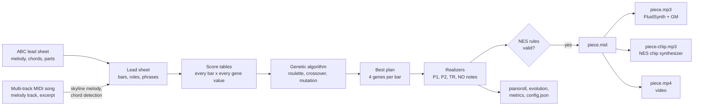
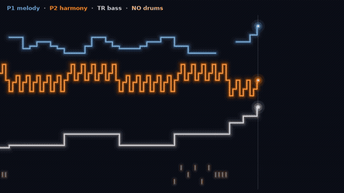
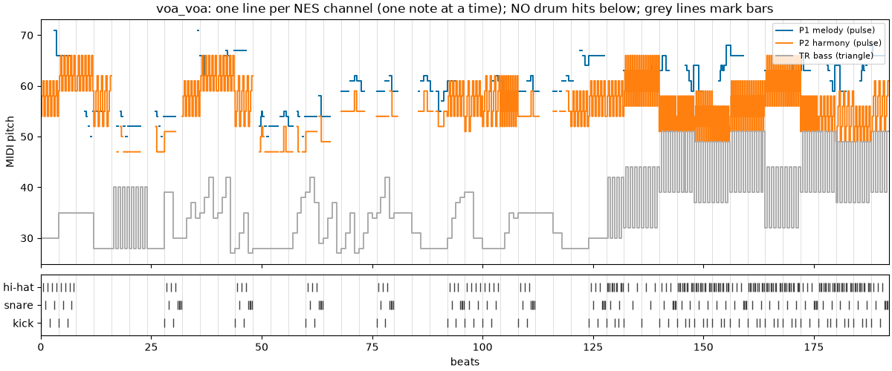

# TP1 – A Genetic Algorithm that Arranges Songs for the NES Sound Chip

DCC831 – Generative AI for Music (UFMG, 2026/2). Assignment 1: algorithmic composition.

This project re-composes a song as 8-bit music. It reads a lead sheet (a melody with chord symbols
and part labels) and arranges it for the four voices of the Nintendo Entertainment System (NES)
sound chip. A **genetic algorithm** (GA) chooses, bar by bar, what each voice plays.

**Listen:** [giowgiow.github.io/dcc831-tp1/listen](https://giowgiow.github.io/dcc831-tp1/listen/)
has a player for the original, General MIDI and chip versions of every piece, and its video.

## Method

**Stylistic constraint: the NES 2A03 four-voice idiom.** The chip has four channels, and each one
plays one note at a time:

| Channel | Wave | Role in the arrangement | Textures the GA can choose per bar |
|---|---|---|---|
| P1 | pulse (square) | melody, as written in the lead sheet | octave: as written, one up, one down |
| P2 | pulse (square) | harmony | hold, 16th arpeggio, 32nd arpeggio, echo of P1, chord tone below the melody |
| TR | triangle | bass | root, octave pump, root–fifth, walking line |
| NO | noise | percussion (kick, snare, hi-hat) | none, half time, eighth beat, sixteenth beat, fill |

Because each channel is monophonic, chords become arpeggios, and a bass line and a drum part must
be invented. That is why an 8-bit cover is a re-composition and not a copy. Every arrangement is
checked against these rules before export: one note at a time per channel, the channel pitch
ranges (pulse MIDI 33–108, triangle 21–108), chord tones on strong beats for P2 and TR, and
complete 4/4 bars.

**Genetic algorithm.**

- **Genotype:** 4 integer genes per bar (P2 texture, TR texture, NO pattern, P1 octave).
  Deterministic *realizers* turn each gene value into the notes of the bar, so every genotype is
  a valid arrangement.
- **Initial population:** random genotypes (60 by default).
- **Fitness:** a weighted mean of seven music-theory criteria, each from 0 to 1:
  - *complementarity*: P2 calm when the melody is busy, active when it rests;
  - *register*: P2 below P1;
  - *coherence*: the same textures inside a 4-bar phrase (a drum fill may close the phrase);
  - *contrast*: the chorus denser than the verse;
  - *bass smoothness*: small leaps along the bass line, inside bars and across bar lines (the
    upper notes of the octave pump are an ornament, not leaps);
  - *idiom*: arpeggios over bars with a single chord, drum fills exactly at phrase ends;
  - *fidelity*: the melody stays in its written octave.
- **Selection:** roulette wheel with windowing (fitness minus the generation's minimum), plus
  elitism (the 2 best plans survive unchanged).
- **Crossover:** one cut point, only between bars.
- **Mutation:** each gene changes with probability 0.01.
- **Stopping:** 3000 generations, or 300 generations without improvement (4000 and 400 for the
  MIDI songs). With these windows, no single-gene change improves the final plans of the ABC
  tunes; on the longer MIDI songs it adds at most 0.005.

All hyperparameters are in [configs/default.json](configs/default.json) and can be changed with
`--set`, for example `--set weights.contrast=3`. The design is in
[specs/001-ga-chiptune-arranger/](specs/001-ga-chiptune-arranger/).



## Layout

- `src/`: source code (entry point: `src/main.py`)
  - `leadsheet/`: ABC and MIDI reading, chord helpers
  - `arrangement/`: realizers, assembly, NES rule validation
  - `ga/`: genotype, operators, score tables, fitness, evolution loop
  - `analysis/`: objective metrics
  - `export/`: MIDI, audio (General MIDI and chip), figures, videos, run folders
- `data/leadsheets/`: the input lead sheets (two written by hand, six reduced from MIDI songs)
- `data/sources.json`: where each MIDI song comes from (URL, SHA-256, lead-sheet settings)
- `configs/default.json`: default hyperparameters
- `tests/`: tests (pytest); the docstring examples in `src/` also run as tests
- `samples/`: curated generated pieces (MIDI, MP3, piano roll, evolution, metrics, config, notes)
- `outputs/`: every generation run, one folder per run (not versioned)
- `listen/`: a static listening page (audio players and videos of every sample), served by GitHub
  Pages
- `paper/`: the ISMIR abstract (`tp1.tex`), with the official ISMIR 2026 template files from
  [ismir/paper_templates@2026v1](https://github.com/ismir/paper_templates/tree/2026v1/2026/latex)
- `specs/` and `.specify/`: [Spec Kit](https://github.com/github/spec-kit) design documents; the
  project rules are in `.specify/memory/constitution.md`

## Installation

The project uses [uv](https://docs.astral.sh/uv/) and Python 3.12.

```bash
uv sync
```

Without uv, use `requirements.txt`:

```bash
python3 -m venv .venv && source .venv/bin/activate && pip install -r requirements.txt
```

To render audio, install FluidSynth, a General MIDI soundfont and ffmpeg. On Debian/Ubuntu:

```bash
sudo apt install fluidsynth fluid-soundfont-gm ffmpeg
```

## Usage

Arrange an ABC lead sheet (the seed is required):

```bash
uv run src/main.py arrange data/leadsheets/korobeiniki.abc --seed 1
```

Arrange a multi-track MIDI song. The song is first reduced to a lead sheet:

- the melody comes from the chosen track or tracks;
- one chord is detected per half bar from the other tracks;
- `midi.bars` picks an excerpt, and `midi.sections` marks where each part starts.

```bash
uv run src/main.py arrange data/raw/chiclete/voa_voa.mid --seed 1 \
    --set midi.melody_track=3 --set 'midi.bars=[8,56]' \
    --set 'midi.sections=[[0,"A"],[16,"Pre"],[32,"Chorus"]]'
```

MIDI files recorded live may not follow their own tempo. "Voa Voa" says 120 BPM but was played at
about 110 BPM. When the drum hits do not fit the file's grid, the reader estimates the real beat
grid from the drums (`midi.grid` is `"auto"` by default; `"file"` or `[bpm, downbeat_seconds]`
force a grid).

Each run writes `outputs/<input>-s<seed>-<config hash>/` with:

- `piece.mid`;
- `piece.mp3` (General MIDI timbres) and `piece-chip.mp3` (the project's NES chip synthesizer);
  `--renderer gm|chip|both` picks the renderers, and `both` is the default;
- `input.mid` and `input.mp3`: the input made audible for comparison;
- `pianoroll.png` and `pianoroll.pdf`;
- `evolution.csv`, `evolution.png` and `evolution.pdf`;
- `metrics.json`;
- `config.json`: the seed, every hyperparameter, the input hash, the git commit and the date.

Copy a run to the curated samples (and its vector figures to `paper/figures/`), and render its
"Bach Vision Test" style video (`piece.mp4`, with the chip audio):

```bash
uv run src/main.py sample outputs/<run-id> <sample-name>
uv run src/main.py video samples/<sample-name>
```

Run the tests:

```bash
uv run pytest
```

## Reproducing the results

Each sample was made by one `arrange` command and copied with `sample`. The same command
rebuilds the same notes. The run folder name ends with the hash of the configuration: `39aaf0de`
is the default configuration.

```bash
uv run src/main.py arrange data/leadsheets/ievan_polkka.abc --seed 1
uv run src/main.py sample outputs/ievan_polkka-s1-39aaf0de ievan-polkka-s1
```

```bash
uv run src/main.py arrange data/leadsheets/ievan_polkka.abc --seed 1 --set weights.contrast=0
uv run src/main.py sample outputs/ievan_polkka-s1-5bb65127 ievan-polkka-s1-contrast0
```

```bash
uv run src/main.py arrange data/leadsheets/korobeiniki.abc --seed 1
uv run src/main.py sample outputs/korobeiniki-s1-39aaf0de korobeiniki-s1
```

```bash
uv run src/main.py arrange data/leadsheets/korobeiniki.abc --seed 2
uv run src/main.py sample outputs/korobeiniki-s2-39aaf0de korobeiniki-s2
```

The MIDI songs need their source files in `data/raw/`. This command downloads the five that are on
the web and checks each file against the SHA-256 hash recorded in
[`data/sources.json`](data/sources.json). It skips files already present, and it stops with an
error if a site now serves a different file. "Voa Voa" has no public download, so the command only
reports it.

```bash
uv run src/main.py fetch
```

Each command below sets the melody track, the bar excerpt and the sections. The longer songs use
up to 4000 generations with a stagnation window of 400:

```bash
G="--set max_generations=4000 --set stagnation_window=400"
uv run src/main.py arrange data/raw/chiclete/voa_voa.mid --seed 1 $G --set midi.melody_track=3 \
    --set 'midi.bars=[8,56]' --set 'midi.sections=[[0,"A"],[16,"Pre"],[32,"Chorus"]]'
uv run src/main.py arrange data/raw/mpb/mulher_de_fases.mid --seed 1 $G --set midi.melody_track=6 \
    --set 'midi.bars=[8,40]' --set 'midi.sections=[[0,"A"],[8,"Chorus"],[16,"A"],[24,"Chorus"]]'
uv run src/main.py arrange data/raw/mpb/amor_i_love_you.mid --seed 1 $G --set midi.melody_track=2 \
    --set 'midi.bars=[0,56]' --set 'midi.sections=[[0,"A"],[16,"B"],[24,"A"],[40,"Chorus"]]'
uv run src/main.py arrange data/raw/mpb/por_voce_bk.mid --seed 1 $G --set midi.melody_track=4 \
    --set 'midi.bars=[4,48]' --set 'midi.sections=[[0,"A"],[20,"Pre"],[28,"Chorus"]]'
uv run src/main.py arrange data/raw/mpb/aquarela.mid --seed 1 $G --set midi.melody_track=3 \
    --set 'midi.bars=[4,36]' --set 'midi.sections=[[0,"A"],[16,"B"]]'
uv run src/main.py arrange data/raw/mpb/fico_assim_sem_voce.mid --seed 1 $G --set midi.melody_track=1 \
    --set 'midi.bars=[10,58]' --set 'midi.sections=[[0,"A"],[16,"A"],[32,"Chorus"]]'
```

Then copy each run to `samples/` with the names used below, for example
`uv run src/main.py sample outputs/voa_voa-s1-ccca2416 voa-voa-s1`. The run folders are:

- `voa_voa-s1-ccca2416`
- `mulher_de_fases-s1-7de7248c`
- `amor_i_love_you-s1-e24d1066`
- `por_voce_bk-s1-c9ff249f`
- `aquarela-s1-d9735b16`
- `fico_assim_sem_voce-s1-d4fbaf8e`

Videos: `uv run src/main.py video samples/<sample-name>` for each sample.

Comparison videos (the three versions one after the other, at most 9.5 MB so that GitHub plays
them inline in this README): `uv run src/main.py compare samples/<sample-name>`, written to
`outputs/compare/`. Two titles need their accents: `--title "Por Você (s1)"` and
`--title "Fico Assim Sem Você (s1)"`.

**Without the MIDI files.** The committed ABC lead sheets hold the same lead sheets (the tests check
it for every song), so a fresh clone can rerun every MIDI sample from them, Voa Voa included:

```bash
G="--set max_generations=4000 --set stagnation_window=400"
uv run src/main.py arrange data/leadsheets/voa_voa.abc --seed 1 $G
uv run src/main.py arrange data/leadsheets/mulher_de_fases.abc --seed 1 $G
uv run src/main.py arrange data/leadsheets/amor_i_love_you.abc --seed 1 $G
uv run src/main.py arrange data/leadsheets/por_voce.abc --seed 1 $G
uv run src/main.py arrange data/leadsheets/fico_assim_sem_voce.abc --seed 1 $G
uv run src/main.py arrange data/leadsheets/aquarela.abc --seed 1 $G
```

These runs reach the same best fitness, in the same number of generations, with the same
arrangement as the samples. Three things differ:

- the run folder name, because the `midi` settings are no longer part of the configuration;
- `input.mp3`, which plays the plain lead sheet instead of the original MIDI excerpt;
- for the four songs whose tempo has more than six decimals (Voa Voa, Mulher de Fases, Amor I Love
  You, Fico Assim Sem Você), the ABC `Q:` field keeps six decimals, so 4 to 13% of the note events
  in `piece.mid` land one MIDI tick (about 2 ms) away.

The ABC lead sheets are rebuilt from the MIDI files with the settings recorded in each sample:

```bash
uv run src/main.py abc --all                 # every song of data/sources.json
uv run src/main.py abc samples/aquarela-s1   # one song
```

The experiments of the abstract compare 5 seeds, a random-search baseline and an ablation that
sets each criterion weight to 0. Each command writes `outputs/experiment-<song>-s1-<hash>/`
with `results.csv`, `results.md` and `seeds.pdf`:

```bash
uv run src/main.py experiment data/leadsheets/ievan_polkka.abc --seed 1
uv run src/main.py experiment data/leadsheets/korobeiniki.abc --seed 1
```

## Generated pieces



*Korobeiniki, seed 1, in the bridge. The image shows a few seconds of the video: P1 is the melody
(blue), P2 the arpeggios (orange), TR the octave-pump bass (grey), and the bottom band holds the
drum hits of a sixteenth-note beat.*

The [listening page](https://giowgiow.github.io/dcc831-tp1/listen/) plays every version in the
browser. Each song below starts with a short video that plays its three renderings one after the other:
the original input, the generated arrangement with General MIDI timbres, and the same arrangement
on the NES chip synthesizer (made with `uv run src/main.py compare`). Then come links to each
file, the full video, and the folder with every other file:

- `piece.mid`;
- the piano roll;
- the evolution log and figure;
- `metrics.json` and `config.json`;
- the listening notes, `notes.md`.

For an ABC tune, the original is the lead sheet played plainly (piano melody, block chords,
bass). For a MIDI song, the original is the fan-made MIDI file itself, rendered with the same
soundfont and cut to the same bars.

### Ievan Polkka

https://github.com/user-attachments/assets/99c51840-345a-4198-97d8-bc2bc49dde6a

| Original | Generated (General MIDI) | Generated (chip) | Video |
|---|---|---|---|
| [input.mp3](samples/ievan-polkka-s1/input.mp3) | [piece.mp3](samples/ievan-polkka-s1/piece.mp3) | [piece-chip.mp3](samples/ievan-polkka-s1/piece-chip.mp3) | [piece.mp4](samples/ievan-polkka-s1/piece.mp4) |

Input: ABC lead sheet (Loituma melody). Varied: default. Best fitness 0.912. Files and notes: [ievan-polkka-s1](samples/ievan-polkka-s1/).

### Ievan Polkka, contrast weight 0

https://github.com/user-attachments/assets/ad1cb685-7217-4201-8f42-4a59e0ab2074

| Original | Generated (General MIDI) | Generated (chip) | Video |
|---|---|---|---|
| [input.mp3](samples/ievan-polkka-s1-contrast0/input.mp3) | [piece.mp3](samples/ievan-polkka-s1-contrast0/piece.mp3) | [piece-chip.mp3](samples/ievan-polkka-s1-contrast0/piece-chip.mp3) | [piece.mp4](samples/ievan-polkka-s1-contrast0/piece.mp4) |

Input: same lead sheet. Varied: hyperparameter: contrast weight 0. Best fitness 0.887*. Files and notes: [ievan-polkka-s1-contrast0](samples/ievan-polkka-s1-contrast0/).

### Korobeiniki (Tetris theme)

https://github.com/user-attachments/assets/ed86c752-3502-4d88-819d-08527809bdf2

| Original | Generated (General MIDI) | Generated (chip) | Video |
|---|---|---|---|
| [input.mp3](samples/korobeiniki-s1/input.mp3) | [piece.mp3](samples/korobeiniki-s1/piece.mp3) | [piece-chip.mp3](samples/korobeiniki-s1/piece-chip.mp3) | [piece.mp4](samples/korobeiniki-s1/piece.mp4) |

Input: ABC lead sheet. Varied: default. Best fitness 0.922. Files and notes: [korobeiniki-s1](samples/korobeiniki-s1/).

### Korobeiniki, seed 2

https://github.com/user-attachments/assets/2db22bab-f7a2-440a-aad0-40713cbeeffc

| Original | Generated (General MIDI) | Generated (chip) | Video |
|---|---|---|---|
| [input.mp3](samples/korobeiniki-s2/input.mp3) | [piece.mp3](samples/korobeiniki-s2/piece.mp3) | [piece-chip.mp3](samples/korobeiniki-s2/piece-chip.mp3) | [piece.mp4](samples/korobeiniki-s2/piece.mp4) |

Input: same lead sheet. Varied: seed 2. Best fitness 0.936. Files and notes: [korobeiniki-s2](samples/korobeiniki-s2/).

### Voa Voa (Chiclete com Banana)

https://github.com/user-attachments/assets/98330022-99aa-4a24-a5ba-5c3d18ca5851

| Original | Generated (General MIDI) | Generated (chip) | Video |
|---|---|---|---|
| [input.mp3](samples/voa-voa-s1/input.mp3) | [piece.mp3](samples/voa-voa-s1/piece.mp3) | [piece-chip.mp3](samples/voa-voa-s1/piece-chip.mp3) | [piece.mp4](samples/voa-voa-s1/piece.mp4) |

Input: MIDI, bars 8–56. Varied: beat grid re-estimated (110 BPM). Best fitness 0.853. Files and notes: [voa-voa-s1](samples/voa-voa-s1/).

### Mulher de Fases (Raimundos)

https://github.com/user-attachments/assets/729d8893-a89e-42a3-8c57-ea96e56264ef

| Original | Generated (General MIDI) | Generated (chip) | Video |
|---|---|---|---|
| [input.mp3](samples/mulher-de-fases-s1/input.mp3) | [piece.mp3](samples/mulher-de-fases-s1/piece.mp3) | [piece-chip.mp3](samples/mulher-de-fases-s1/piece-chip.mp3) | [piece.mp4](samples/mulher-de-fases-s1/piece.mp4) |

Input: MIDI, bars 8–40. Varied: melody: harmonica track. Best fitness 0.896. Files and notes: [mulher-de-fases-s1](samples/mulher-de-fases-s1/).

### Amor I Love You (Marisa Monte)

https://github.com/user-attachments/assets/6f264358-9aed-4a30-94af-263ae51860e7

| Original | Generated (General MIDI) | Generated (chip) | Video |
|---|---|---|---|
| [input.mp3](samples/amor-i-love-you-s1/input.mp3) | [piece.mp3](samples/amor-i-love-you-s1/piece.mp3) | [piece-chip.mp3](samples/amor-i-love-you-s1/piece-chip.mp3) | [piece.mp4](samples/amor-i-love-you-s1/piece.mp4) |

Input: MIDI, bars 0–56. Varied: melody: flute track. Best fitness 0.833. Files and notes: [amor-i-love-you-s1](samples/amor-i-love-you-s1/).

### Por Você (Barão Vermelho)

https://github.com/user-attachments/assets/db636566-d785-40f3-93da-748810e7ba9e

| Original | Generated (General MIDI) | Generated (chip) | Video |
|---|---|---|---|
| [input.mp3](samples/por-voce-s1/input.mp3) | [piece.mp3](samples/por-voce-s1/piece.mp3) | [piece-chip.mp3](samples/por-voce-s1/piece-chip.mp3) | [piece.mp4](samples/por-voce-s1/piece.mp4) |

Input: MIDI, bars 4–48. Varied: melody: flute track. Best fitness 0.896. Files and notes: [por-voce-s1](samples/por-voce-s1/).

### Aquarela (Toquinho)

https://github.com/user-attachments/assets/3817c82d-7437-4acc-b5e5-8bc74fa71341

| Original | Generated (General MIDI) | Generated (chip) | Video |
|---|---|---|---|
| [input.mp3](samples/aquarela-s1/input.mp3) | [piece.mp3](samples/aquarela-s1/piece.mp3) | [piece-chip.mp3](samples/aquarela-s1/piece-chip.mp3) | [piece.mp4](samples/aquarela-s1/piece.mp4) |

Input: MIDI, bars 4–36. Varied: melody: clarinet track. Best fitness 0.895. Files and notes: [aquarela-s1](samples/aquarela-s1/).

### Fico Assim Sem Você (Adriana Calcanhotto)

https://github.com/user-attachments/assets/7f29034f-1020-4e59-94bf-a92bbf5ac99c

| Original | Generated (General MIDI) | Generated (chip) | Video |
|---|---|---|---|
| [input.mp3](samples/fico-assim-sem-voce-s1/input.mp3) | [piece.mp3](samples/fico-assim-sem-voce-s1/piece.mp3) | [piece-chip.mp3](samples/fico-assim-sem-voce-s1/piece-chip.mp3) | [piece.mp4](samples/fico-assim-sem-voce-s1/piece.mp4) |

Input: MIDI, bars 10–58. Varied: melody: flute track. Best fitness 0.891. Files and notes: [fico-assim-sem-voce-s1](samples/fico-assim-sem-voce-s1/).

\* The contrast-0 run is scored without the contrast criterion, so its fitness is not comparable
with the others.

How to read the results:

- **Stopping:** every run stopped after its stagnation window (300 generations for the ABC
  tunes, 400 for the MIDI songs), except Voa Voa, which reached the 4000-generation cap.
- **The MIDI songs score lower** (0.83–0.90 against 0.91–0.94) for two reasons:
  - Their melodies often sit in octave 3 or 4. That pits the register criterion against fidelity.
  - They are longer, and their chords are detected automatically.

Piano rolls of two arrangements (every sample folder has its own `pianoroll.png`):

| Korobeiniki, seed 1 | Voa Voa, seed 1 |
|---|---|
|  |  |

## Inputs, sources and licenses

- **Ievan Polkka** ([data/leadsheets/ievan_polkka.abc](data/leadsheets/ievan_polkka.abc)).
  - The melody is a traditional Finnish polka, in the public domain.
  - The melody and bass harmony come from the transcription of tune 341 on
    [flutetunes.com](https://www.flutetunes.com/tunes.php?id=341), which follows Loituma's
    recording.
  - The lead sheet transposes it from D minor to E-flat minor (the key of Loituma's recording),
    rebars it to 4/4, and adds chord symbols (Ebm, Bbm, Bbm7) taken from the bass line.
  - Loituma's arrangement and the lyrics are not used.
- **Korobeiniki** ([data/leadsheets/korobeiniki.abc](data/leadsheets/korobeiniki.abc)).
  - A traditional Russian melody, known as the Tetris theme.
  - The lead sheet was written for this project, in the A A B A form of the game version.

- **MIDI songs: third-party MIDI sequences**, kept out of the repository in `data/raw/`
  (gitignored). The songs are copyrighted, and so are the sequences. The manifest
  [`data/sources.json`](data/sources.json) records, for each song, the page and the direct link of
  the file, its SHA-256 hash, where it is saved, and the settings that reduce it to a lead sheet.
  `uv run src/main.py fetch` downloads the files and checks the hashes (see "Reproducing the
  results").

  | Song | Performer (composers) | Source of the MIDI file | File in `data/raw/` |
  | --- | --- | --- | --- |
  | Voa Voa | Chiclete com Banana | collected by the student from the description of a YouTube video; no public download | `chiclete/voa_voa.mid` |
  | Mulher de Fases | Raimundos (Digão, Rodolfo) | [Beatriz Kauffmann's Web Site](https://www.beakauffmann.com/mpb_m/mulher-de-fases.html) | `mpb/mulher_de_fases.mid` |
  | Amor I Love You | Marisa Monte (Carlinhos Brown, Marisa Monte) | [Beatriz Kauffmann's Web Site](https://www.beakauffmann.com/mpb_a/amor-I-love-you.html) | `mpb/amor_i_love_you.mid` |
  | Por Você | Barão Vermelho (Frejat, Maurício Barros, Mauro Santa Cecília) | [Beatriz Kauffmann's Web Site](https://www.beakauffmann.com/mpb_p/por-voce.html) | `mpb/por_voce_bk.mid` |
  | Fico Assim Sem Você | Adriana Calcanhotto (Abdullah, Cacá Moraes) | [Beatriz Kauffmann's Web Site](https://www.beakauffmann.com/mpb_f/fico-assim-sem-voce.html) | `mpb/fico_assim_sem_voce.mid` |
  | Aquarela | Toquinho | [BitMidi](https://bitmidi.com/aquarela-mid), file 7390 | `mpb/aquarela.mid` |

  - No site states a license. Some files carry their own credits: "Mulher de Fases" and "Amor I
    Love You" say "Copyright © 2000 by Editora Zardo Ltda."; "Fico Assim Sem Você" says
    "Copyright © Editora HMP" and "Sequenciado por Marcos Borelli" (its page names Claudinho &
    Buchecha as the reference recording, the file names Adriana Calcanhotto's version);
    "Aquarela" is a Soft Karaoke file (lyrics as text events, melody on a clarinet track) credited
    to "Karaokê do Brasil – Família Ribeiro – 1999"; "Voa Voa" names an editor, "Fernando" (2014).
  - **Our reduction, committed.** For each song, `data/leadsheets/` holds an ABC lead sheet that
    is the project's own reinterpretation of the song: the melody of one track, the chords
    detected in the other tracks every half bar, and the part labels the student marked. It holds
    no accompaniment, lyrics or arrangement of the original file. The header of each ABC file
    states the song, its source, the melody track and bars used, and the command that wrote it.
    These files are kept for academic use in this course, so that the arranger can be rerun even
    if a site goes away: reading one gives exactly the lead sheet that the arranger read from the
    MIDI file.
  - The samples hold only the arranged output and the rendered input excerpt used for comparison.
  - In the four Beatriz Kauffmann files, the melody track was found by matching the lyric
    syllables embedded in the file to note onsets: one track meets all of them. For Voa Voa and
    Aquarela, the melody is the monophonic line that plays throughout (tenor sax, clarinet).

## AI usage

This project was developed with Claude Code (Anthropic), under the student's direction:

- **Brainstorming and research:** the 8-bit arrangement idea, the choice of the GA, and the check
  of the design against the course material and the papers of the reference library.
- **Writing the Spec Kit documents:** spec, plan, data model and tasks.
- **Writing code and tests:** test-first, with parallel subagents per module.
- **Producing the inputs:** the transcription of the lead sheets.
- **Drafting the README and the abstract.**

The student chose the method, the stylistic constraint and the songs, checked the lead sheets and
the generated pieces by ear, and reviewed every result.

## Deferred items

The constitution asks for a marimo walkthrough notebook, `docs/glossary.md` and
`docs/explanation.md`. They were deferred past the 2026-10-11 deadline, as recorded in
`specs/001-ga-chiptune-arranger/plan.md`.

## License

The code and documentation in this repository are released under the
[GNU General Public License v3.0 or later](LICENSE).
The ISMIR template files in `paper/` (style, bibliography style and example files) come from
[ismir/paper_templates](https://github.com/ismir/paper_templates) and keep their original terms.
